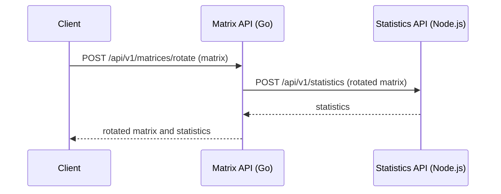
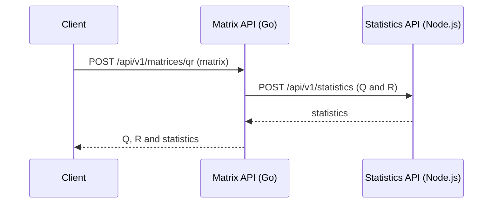

# Matrix Challenge

This repository contains two backend services for Matrix Processing.

## Live demo

The Matrix API is currently deployed on Azure Container Apps:

- [Health](https://matrix.orangetree-860309f6.eastus2.azurecontainerapps.io/health)
- [Interactive API reference](https://matrix.orangetree-860309f6.eastus2.azurecontainerapps.io/docs)
- [OpenAPI document](https://matrix.orangetree-860309f6.eastus2.azurecontainerapps.io/openapi.yaml)

The deployed versions are `matrix-v1.0.0` and `statistics-v1.0.0`. The demo URL is valid while the Azure resources remain deployed.

## Request flow

### Rotation



### QR factorization



## Run locally

You need Docker with Compose. From the repository root, start both services in one terminal:

```sh
docker compose up --build
```

In another terminal, send a request to the public API:

```sh
curl -sS http://localhost:8080/api/v1/matrices/rotate \
  -H 'Content-Type: application/json' \
  -d '{"matrix":[[1,2,3],[4,5,6]]}'
```

The response is:

```json
{
  "rotated": [[4, 1], [5, 2], [6, 3]],
  "statistics": {
    "min": 1,
    "max": 6,
    "sum": 21,
    "average": 3.5,
    "hasDiagonalMatrix": false
  }
}
```

Run `docker compose down` from the repository root when finished.

## API reference

- Matrix API: [interactive documentation](http://localhost:8080/docs) or its [OpenAPI document](matrix-service/openapi.yaml).
- Statistics API: [interactive documentation](http://localhost:3000/docs) or its [OpenAPI document](statistics-service/openapi.yaml).

The [architecture decisions](docs/architecture.md) explain the challenge's rotation and QR ambiguity, the request flow, and why Go combines the final response.

## Verify the source

These commands require Go and Node.js with pnpm. Run each command from the repository root:

```sh
(cd matrix-service && go test ./...)
(cd statistics-service && pnpm install --frozen-lockfile && pnpm test)
```

## Deploy to Azure

Terraform prepares the Azure environment and image registry. Each service has separate CI and deployment workflows. CI runs on pull requests and pushes to `main` affecting that service. Publish a Git tag such as `matrix-v1.0.0` or `statistics-v1.0.0` to test, build and deploy that service as image version `1.0.0`.

Follow the [Azure deployment guide](docs/deploy-azure.md) for the initial setup and public API URL.
