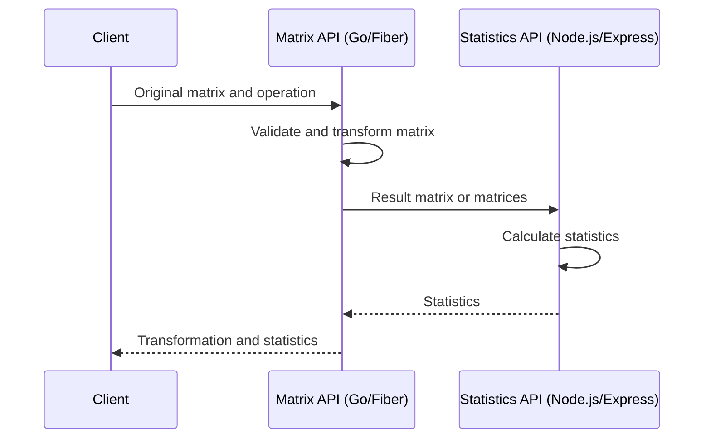

# Architecture Decisions

## Requirement ambiguity

The challenge describes two transformations for the Go API in different sections: matrix rotation and QR factorization. It also says that Go sends its result to Node.js.

This implementation supports both transformations as separate operations and follows the required backend-to-backend communication: clients call Go, and Go calls Node.js over HTTP.

## Responsibilities

The Matrix API is the public entry point. It validates the original matrix, performs the requested transformation, sends the resulting matrix or matrices to the Statistics API, and combines both results in its response.

The Statistics API is internal. It calculates the minimum, maximum, sum, average, and whether any received matrix is diagonal. It does not rotate matrices, calculate QR factorizations, or own the client-facing response.

## Request flow

For rotation, Go sends the rotated matrix to Node and returns `rotated` with `statistics`. For QR factorization, Go sends both `Q` and `R` and returns `q`, `r`, and `statistics`.

Go combines the response because it receives the original client request and the challenge requires it to return the rotation or QR factorization. Node's result is the HTTP response to its caller, which is Go, not the external client.

## HTTP contracts

The Matrix API exposes:

- `POST /api/v1/matrices/rotate`
- `POST /api/v1/matrices/qr`

The internal Statistics API exposes:

- `POST /api/v1/statistics`

Both contracts are defined in their respective `openapi.yaml` files and rendered with Scalar at `/docs`.

## Network boundary

In Azure Container Apps, the Matrix API has external HTTPS ingress and the Statistics API has internal ingress. Go reaches Node through `http://statistics`, using Container Apps service discovery.

Docker Compose publishes the Statistics API on port `3000` for local development and access to its API reference. This local port does not change the production boundary.

## Consequences

This design keeps transformation and statistics responsibilities separate, provides one public entry point, and allows the Statistics API to process either one rotated matrix or the two QR result matrices.

The Matrix API depends on the Statistics API to complete a request. If Node is unavailable or returns an invalid response, Go returns `502 Bad Gateway` rather than returning a partial result.
